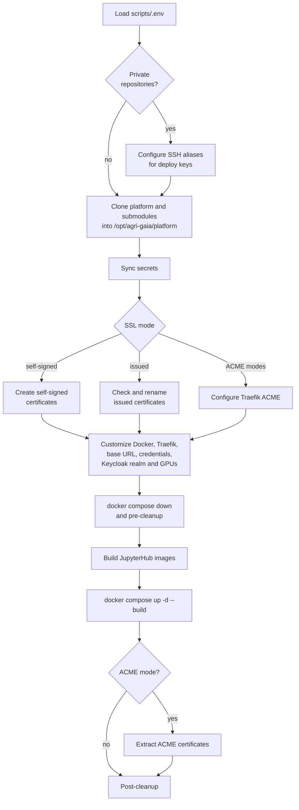

<div align="center">


# Agri-Gaia Platform Deployment

**Automated, reproducible deployments of the Agri-Gaia platform on single hosts or across multiple instances.**

[](CHANGELOG.md)
[](LICENSE)
[](#-requirements)
[](scripts)
[](https://docs.docker.com/compose/)

[Quick Start](#-quick-start) ·
[Configuration](#-create-the-deployment-configuration) ·
[How It Works](#-how-deploysh-works) ·
[Multiple Instances](#-managing-multiple-instances) ·
[Migration](#-migration)

</div>

---

## 📖 Table of Contents

- [Overview](#-overview)
- [Requirements](#-requirements)
- [Quick Start](#-quick-start)
- [Prerequisites](#-prerequisites)
- [Create the Deployment Configuration](#-create-the-deployment-configuration)
- [Set Up the Host](#-set-up-the-host)
- [Place Secrets](#-place-secrets)
- [Run `deploy.sh`](#-run-deploysh)
- [How `deploy.sh` Works](#-how-deploysh-works)
- [Migration](#-migration)
- [Managing Multiple Instances](#-managing-multiple-instances)
- [Related Repositories](#-related-repositories)
- [Changelog](#-changelog)
- [License](#-license)

## 🌱 Overview

This repository contains the scripts used to deploy the [Agri-Gaia platform](https://github.com/hsos-ai-lab/agri-gaia-platform) on a server. They take care of:

- **configuration**: an interactive setup that generates secure credentials;
- **host setup**: Docker, utilities and the NVIDIA Container Toolkit;
- **source checkout**: cloning the platform and its submodules;
- **TLS certificates**: provisioning in one of five supported modes;
- **startup**: launching the Docker Compose stack.

They also support redeploying multiple instances remotely.


All files of a deployment live below `/opt/agri-gaia` (`AG_SOURCE_DIR`):

```text
/opt/agri-gaia/
├── deploy/      # This repository (scripts, .env, logs)
├── secrets/     # Secrets that persist across deployments (EDC keystore, certificates)
└── platform/    # Checkout of agri-gaia-platform, re-created on every deployment
```

## 📋 Requirements

| Requirement | Details |
|-------------|---------|
| Operating system | Ubuntu **20.04**, **22.04** or **24.04** (x86_64). Docker packages are pinned per release in [`packages/preferences.d`](packages/preferences.d) |
| Privileges | `root` access on the target host |
| Hardware | At least 16 GB RAM (32 GB recommended), see the [platform requirements](https://github.com/hsos-ai-lab/agri-gaia-platform#-requirements) |
| DNS | A domain (`AG_PROJECT_BASE_URL`) with wildcard sub-domains pointing to the host |
| GPU (optional) | NVIDIA GPU with driver **575 or newer** (required by Triton 24.09, see [MIGRATION.md](MIGRATION.md)) |

## ⚡ Quick Start

```bash
# 1. Clone this repository (as root)
mkdir -p /opt/agri-gaia && cd /opt/agri-gaia \
  && git clone https://github.com/hsos-ai-lab/agri-gaia-platform-deployment.git deploy \
  && cd deploy

# 2. Answer the configuration prompts
./setup-env.sh

# 3. Install Docker, utilities and (if a GPU is present) the NVIDIA Container Toolkit
./setup-host.sh

# 4. Place the EDC keystore
mkdir -p /opt/agri-gaia/secrets/edc
cp /path/to/keystore.jks /opt/agri-gaia/secrets/edc/keystore.jks

# 5. Deploy
./deploy.sh
```

Each step is described in detail below.

## 🧩 Prerequisites

> [!IMPORTANT]
> All commands and scripts in this guide must be run as `root` on the target host.

### Install deploy keys

> [!NOTE]
> This step is only required if you are **not** using the [public GitHub repositories](https://github.com/hsos-ai-lab) of the Agri-Gaia project.

From a remote machine that already uses the GitLab and GitHub deploy keys, copy the required SSH keys to the new platform host:

```bash
scp -i ~/.ssh/agri-gaia-keypair/id_ed25519 -r \
  root@remote:/root/.ssh/agri-gaia \
  root@host:/root/.ssh
```

The `/root/.ssh` directory should then contain the following directories with public and private keys:

```text
/root/.ssh/agri-gaia
├── backend
│   ├── id_ed25519
│   └── id_ed25519.pub
├── frontend
│   ├── id_ed25519
│   └── id_ed25519.pub
└── platform
    ├── id_ed25519
    └── id_ed25519.pub
```

### Clone this repository

Clone this repository into `/opt/agri-gaia/deploy`:

```bash
AG_SOURCE_DIR=/opt/agri-gaia \
  ; mkdir -p "${AG_SOURCE_DIR}" \
  && cd "${AG_SOURCE_DIR}" \
  && git clone https://github.com/hsos-ai-lab/agri-gaia-platform-deployment.git deploy \
  && cd deploy
```

> [!WARNING]
> If you have forked this project into a private repository and want to [manage multiple instances](#-managing-multiple-instances), clone the private repository **via SSH using a deploy key**. Otherwise, `git pull` will hang on the remote host while it waits for password authentication.

## 🧾 Create the Deployment Configuration

Run the following command and answer the prompts to create a deployment-specific `.env` file at `scripts/.env`:

```bash
./setup-env.sh
```

See the [example `.env`](scripts/.env.example) file for reference.

> [!NOTE]
> The script exits immediately if `scripts/.env` already exists. To re-run it, remove that file first.

### `setup-env.sh` input reference

The script asks the following questions in order. All inputs are **required** unless marked *optional*.

| Prompt | Variable written to `.env` | Description |
|--------|----------------------------|-------------|
| Git base URL | `AG_GIT_BASE_URL` | Hostname of your Git server without a trailing slash, e.g. `github.com`. Used to construct the clone URLs of all three repositories. |
| Platform repository | `AG_GIT_REPOSITORY_PLATFORM` | Repository name (not the full URL) of the Agri-Gaia platform, e.g. `agri-gaia-platform`. |
| Platform git branch | `AG_GIT_BRANCH_PLATFORM` | Branch or tag to check out when cloning the platform repository, e.g. `main`. |
| Backend repository | `AG_GIT_REPOSITORY_BACKEND` | Repository name of the backend service, e.g. `agri-gaia-backend`. |
| Backend git branch | `AG_GIT_BRANCH_BACKEND` | Branch or tag to use for the backend repository. |
| Frontend repository | `AG_GIT_REPOSITORY_FRONTEND` | Repository name of the frontend service, e.g. `agri-gaia-frontend`. |
| Frontend git branch | `AG_GIT_BRANCH_FRONTEND` | Branch or tag to use for the frontend repository. |
| Git organization | `AG_GIT_ORGANIZATION` | The organization or user that owns all three repositories on the Git server, e.g. `hsos-ai-lab`. |
| Public repositories? | `AG_GIT_PUBLIC_REPOSITORIES` | Answer `Y` if the repositories are publicly accessible without credentials, or `N` if they require SSH deploy keys (see [Install deploy keys](#install-deploy-keys)). |
| Project base URL | `AG_PROJECT_BASE_URL` | The root domain for all platform sub-domains, e.g. `agri-gaia.example.com`. **Must not exceed 50 characters**: Traefik registers wildcard sub-domains, and Let's Encrypt enforces a 64-character CN limit. |
| SSL mode | `AG_SSL_MODE` | TLS certificate strategy (see the table below). Defaults to `lets-encrypt-http` if left blank. |

#### SSL mode options

| Value | When to use | Additional prompts triggered |
|-------|-------------|------------------------------|
| `lets-encrypt-http` | Public server reachable on port 80; Let's Encrypt HTTP-01 challenge. | ACME email |
| `lets-encrypt-dns` | Server behind a firewall or using DuckDNS dynamic DNS; Let's Encrypt DNS-01 challenge. | ACME email, DuckDNS token |
| `http-acme-eab` | Private or enterprise CA with External Account Binding (e.g. HARICA). | ACME email, CA server URL, EAB key ID, EAB HMAC |
| `issued` | You already have a wildcard `.crt` / `.key` pair from a trusted CA; no automated renewal. | *(none)* |
| `self-signed` | Local or air-gapped development environments; browsers will show a warning. | Whether to create or overwrite existing self-signed certificates |

#### Remaining prompts (after SSL mode)

| Prompt | Variable | Description |
|--------|----------|-------------|
| Production deployment? | `AG_DEPLOY_MODE` | Answer `Y` for production. This forces secure credentials and disables public user registration. Answer `N` for a development instance. |
| Secure credentials? *(development only)* | `AG_SECURE_CREDENTIALS` | Shown only when `N` was answered above. Answer `Y` to apply the generated random passwords. Answer `N` to keep the default development credentials from the platform's `.env` (convenient for local testing). |
| NVIDIA NGC API key | `AG_NVIDIA_NGC_API_KEY` | *Optional.* API key from [ngc.nvidia.com](https://ngc.nvidia.com/setup/api-key), used to pull images from NVIDIA's container registry (`nvcr.io`). Leave blank if not needed. |
| GPU IDs | `AG_GPUS` | *Optional.* Comma-separated GPU indices as listed by `nvidia-smi -L` (e.g. `0` or `0,1`). Leave blank on CPU-only hosts. |
| GitHub personal access token | `AG_GITHUB_TOKEN` | *Optional.* Fine-grained GitHub PAT with read access. The backend uses it to query the GitHub API for its third-party license report without hitting rate limits. Leave blank if not needed. |
| Flags for `docker compose down` | `AG_COMPOSE_DOWN_FLAGS` | Flags passed to `docker compose down` at the start of each deployment (e.g. `-v` to also delete all Docker volumes). Leave blank to keep volumes between redeployments. |
| EDC keystore password | `AG_EDC_KEYSTORE_PASSWORD` | Password for the `keystore.jks` file that you place in `/opt/agri-gaia/secrets` (see [Place Secrets](#-place-secrets)). Must match the password the keystore was created with. |

> [!NOTE]
> **Auto-generated values:** after your inputs are collected, the script generates random 20-character alphanumeric passwords for Traefik, Keycloak (admin and database), the realm service account, MinIO, Fuseki, PostgreSQL, PostGIS, CVAT, Grafana and Portainer, and for the EDC and Pontus-X endpoints. They are written to `scripts/.env` and require no action from you.

> [!WARNING]
> Generated passwords, the EDC keystore password and the GitHub token are applied to the platform **only when secure credentials are enabled** (`AG_SECURE_CREDENTIALS=true`). Production deployments always enable secure credentials.

### Advanced settings

The following variables are not prompted for, but can be adjusted in `scripts/.env` before deploying:

| Variable | Default | Description |
|----------|---------|-------------|
| `AG_SOURCE_DIR` | `/opt/agri-gaia` | Root directory of the deployment |
| `AG_COMPOSE_PROFILES` | `edge,annotation,semantics,monitoring,edc,triton` | Docker Compose profiles to start. `annotation` and `semantics` are required |
| `AG_CREATE_SELF_SIGNED` | from prompt | (Re-)create self-signed certificates on every deployment (`self-signed` mode only) |
| `AG_ALLOW_REGISTRATION` | `true` in development, `false` in production | Enables self-registration in Keycloak |
| `AG_VOLUMES_TO_REMOVE` | *(empty)* | Comma-separated Docker volumes to delete before starting (see [Run `deploy.sh`](#-run-deploysh)) |
| `AG_REMOVE_UNMANAGED_CONTAINERS` | `false` | Also removes Nuclio function containers and spawned Jupyter containers before starting |
| `AG_REMOVE_STOPPED_CONTAINERS` | `false` | Runs `docker container prune` after deployment |
| `AG_REMOVE_SOURCE_FILES` | `false` | Deletes the platform sources after deployment, keeping only the secrets |

## 🔨 Set Up the Host

Run the following command to install Docker and the other utilities needed for deployment:

```bash
./setup-host.sh
```

The script:

- installs the required utilities, including `git`, `jq`, `yq`, `screen`, `rsync`, `openssl` and `cron`;
- installs a pinned version of Docker Engine with the Compose and Buildx plugins, matching your Ubuntu release;
- in `self-signed` mode, registers the platform registry as an insecure registry in `/etc/docker/daemon.json`;
- installs the **NVIDIA Container Toolkit** if a compatible GPU is detected and the toolkit is not yet installed.

## 🔐 Place Secrets

Before running `deploy.sh`, create the following directory structure under `/opt/agri-gaia/secrets`. The deployment copies its contents into the cloned platform repository, where Docker Compose picks them up through volume mounts.

The only secret required for a standard deployment is the EDC keystore, which must be placed in the `edc/` subdirectory:

```bash
mkdir -p /opt/agri-gaia/secrets/edc
```

*Optional:* if you plan to use already issued wildcard TLS certificates (`AG_SSL_MODE=issued`) and do not want to create a private fork of the `agri-gaia-platform` repository, create the subdirectory `/opt/agri-gaia/secrets/certs/issued` and place your `.crt` and `.key` files there. The file names are arbitrary: the deployment renames them according to `AG_PROJECT_BASE_URL` from your deployment `.env` file.

### EDC keystore

The Eclipse Dataspace Connector (EDC) requires a Java keystore (`keystore.jks`) to establish secure data-plane connections. Copy it from the machine where it was generated into the `edc/` subdirectory of your secrets folder:

```bash
scp /path/to/keystore.jks root@host:/opt/agri-gaia/secrets/edc/keystore.jks
```

If you are migrating from an existing deployment, the keystore is typically already at `/opt/agri-gaia/secrets/edc/keystore.jks` on the source host:

```bash
scp root@old-host:/opt/agri-gaia/secrets/edc/keystore.jks \
    root@new-host:/opt/agri-gaia/secrets/edc/keystore.jks
```

At this point, `AG_SOURCE_DIR` should contain the following directories. `secrets/certs/*` is optional (see above):

```text
/opt/agri-gaia/
├── deploy
└── secrets
    ├── edc
    │   └── keystore.jks
    └── certs
        └── issued
```

## 🚀 Run `deploy.sh`

Deploy the Agri-Gaia platform with the configuration from your `.env` file:

```bash
# Usage: ./deploy.sh [<AG_GIT_BRANCH_PLATFORM>] [<AG_VOLUMES_TO_REMOVE>]
./deploy.sh
```

This command runs `./scripts/deploy.sh` inside a `screen` session named `<id>.ag-deploy`. Both parameters are optional and override `AG_GIT_BRANCH_PLATFORM` and `AG_VOLUMES_TO_REMOVE`. Any previous `ag-deploy` session is closed first. Attach your terminal to the session with:

```bash
screen -r <id>

# or, if only one screen session is running
screen -r
```

| Action | Command |
|--------|---------|
| List all active screen sessions | `screen -ls` |
| Detach from a screen session | <kbd>Ctrl</kbd>+<kbd>A</kbd>, then <kbd>D</kbd> |

The complete output of each deployment is also written to `logs/<YYYY-MM-DDTHH:MM:SS>.log` in this repository.

## 🔍 How `deploy.sh` Works

The deployment pipeline in [`scripts/deploy.sh`](scripts/deploy.sh) runs the following steps. If a step fails, the deployment stops with a step-specific exit code.



1. **Clone**: the previous `platform/` checkout is removed and the platform repository is cloned fresh, together with its backend and frontend submodules at the configured branches.
2. **Secrets**: `platform/secrets` is backed up to `/opt/agri-gaia/secrets`, and the persistent secrets are then synced into the new checkout.
3. **TLS**: certificates are created, checked or configured according to `AG_SSL_MODE`.
4. **Customization**: the platform's `.env`, Traefik configuration, frontend and Keycloak realm are adapted to `AG_PROJECT_BASE_URL`. Credentials are written when `AG_SECURE_CREDENTIALS=true`. GPU IDs are applied when GPUs are present and `AG_GPUS` is set.
5. **Shutdown and cleanup**: the running stack is stopped with `AG_COMPOSE_DOWN_FLAGS`, `AG_VOLUMES_TO_REMOVE` are deleted, and stale containers and networks are removed. A cron job that removes dangling volumes every three hours is installed.
6. **Startup**: the stack is started with the selected profiles and overrides:
   - `docker-compose.prod.yml` in production;
   - `docker-compose.override.yml` in development;
   - the override for the selected SSL mode;
   - `backend-gpus.yml` on GPU hosts.
7. **Finalization**: in ACME modes, certificates are extracted from `acme.json` and refreshed hourly by cron. Unused images and build caches are pruned.

## 🔄 Migration

For step-by-step upgrade instructions for existing deployments, see [MIGRATION.md](MIGRATION.md). It currently covers:

- **Triton 24.09**: requires NVIDIA driver `575` or newer on GPU hosts.
- **Nuclio 1.16.4**: existing functions must be redeployed with DNS-1123 compliant names.
- **EDC service rename**: `edc-provider.*` becomes `edc.*`, `edc-web.*` and `edc-ids.*`.

## 🌐 Managing Multiple Instances

If multiple instances of the Agri-Gaia platform run on different hosts, their redeployment can be automated with [`redeploy-instances.sh`](redeploy-instances.sh):

1. For each instance, add the following JSON object to the root object in `instances.json` (see [`instances.example.json`](instances.example.json)):

    ```json
    {
      "<name>": {
        "host": "<AG_PROJECT_BASE_URL of instance>",
        "ip": "<host ip>",
        "port": <SSH port of host>,
        "user": "<SSH user on host>",
        "proxy_cmd": null
      }
    }
    ```

    `proxy_cmd` is optional. If set, it is used as the SSH `ProxyCommand` (for example, to connect through a jump host), and `port` is ignored.

2. Make sure your local user can access each host via `ssh` with the *same* key pair. You might have installed that key pair in `~/.ssh/agri-gaia-keypair` or in a different subdirectory.

3. **Private deployment repository only:** make sure the remote host can pull from the private Platform Deployment repository via SSH. Register the SSH public key of the platform repository as a deploy key of the Platform Deployment repository. Then add the following to the *remote host's* `/root/.ssh/config` file:

    ```bash
    set -a
    source scripts/.env
    cat >> /root/.ssh/config <<EOL
    Host agri-gaia-platform-deployment.${AG_GIT_BASE_URL}
          HostName ${AG_GIT_BASE_URL}
          User git
          IdentityFile /root/.ssh/agri-gaia/platform/id_ed25519
          IdentitiesOnly yes
    EOL
    set +a
    ```

4. Run the redeploy script as your local (non-privileged) user:

    ```bash
    ./redeploy-instances.sh \
      -b <git_branch> \
      [-f <instances_file>] \
      [-t <targets>] \
      [-v <volumes_to_remove>] \
      [-i <identity_file>]
    ```

    | Option | Required | Default | Description |
    |--------|----------|---------|-------------|
    | `-b` | yes | – | Platform git branch to deploy |
    | `-f` | no | `instances.json` | Instances file |
    | `-t` | no | all instances | **Comma-separated** list of instance names, without spaces, to redeploy only a subset |
    | `-v` | no | – | **Comma-separated** list of volume names, without spaces, to remove on the remote before redeploying, as shown by `docker volume ls` |
    | `-i` | no | `~/.ssh/agri-gaia-keypair/id_ed25519` | SSH identity file used to connect from your local machine to the hosts |

    The following example redeploys the platform on the `dev` and `testing` instances from the `development` branch. It also removes the `agri_gaia_model-training` and `agri_gaia_cvat-logs` volumes:

    ```bash
    ./redeploy-instances.sh \
      -b development \
      -f instances.json \
      -t dev,testing \
      -v agri_gaia_model-training,agri_gaia_cvat-logs \
      -i ~/.ssh/agri-gaia/platform/id_ed25519
    ```

    The identity file specified by `-i` is used to connect from your local machine to the host system you want to deploy the platform to.

> [!NOTE]
> On each host, the script runs `git pull` in `/opt/agri-gaia/deploy`, followed by `deploy.sh`. Hosts without an `/etc/docker/daemon.json` file are skipped.

## 🔗 Related Repositories

| Repository | Description |
|------------|-------------|
| [agri-gaia-platform](https://github.com/hsos-ai-lab/agri-gaia-platform) | Docker Compose platform definition |
| [agri-gaia-backend](https://github.com/hsos-ai-lab/agri-gaia-backend) | FastAPI backend |
| [agri-gaia-frontend](https://github.com/hsos-ai-lab/agri-gaia-frontend) | React frontend |
| [agri-gaia-platform-deployment](https://github.com/hsos-ai-lab/agri-gaia-platform-deployment) | Scripts for automated production deployments (this repository) |
| [agri-gaia-train-container-template](https://github.com/hsos-ai-lab/agri-gaia-train-container-template) | Template for custom model training containers |
| [agri-gaia-inference-container-template](https://github.com/hsos-ai-lab/agri-gaia-inference-container-template) | Template for custom inference containers |

## 📝 Changelog

All notable changes are documented in [CHANGELOG.md](CHANGELOG.md).

## 📄 License

This project is licensed under the [MIT License](LICENSE).

Copyright © 2024 Osnabrück University of Applied Sciences.
